# Практика 104. Docker

**Студент:** Комаров Максим Сергеевич (GitHub: [Elheid](https://github.com/Elheid))

**Работа:** [Docker for Beginners — Linux](https://training.play-with-docker.com/beginner-linux/)

## Цель работы

- Познакомиться с Docker: образами, контейнерами, Dockerfile, публикацией портов, bind mounts и реестром Docker Hub.
- Изучить базовые команды Linux, используемые при работе с контейнерами.

## Окружение

В Play with Docker терминал справа так и не появился («If the commandline doesn't appear in the
terminal, make sure popups are enabled or try resizing the browser window»), даже после входа
через Docker ID. Поэтому работа выполнена **локально** по той же инструкции:

- Windows, терминал MSYS2 (UCRT64);
- Docker Desktop: Linux-контейнеры работают в виртуальной машине `desktop-linux` (WSL2);
- Docker ID: `elheid`, опубликованные образы: https://hub.docker.com/r/elheid/linux_tweet_app

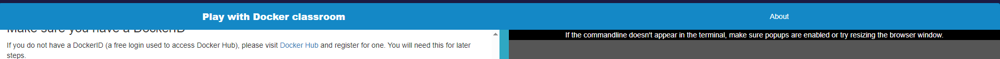

## Структура каталога

```
КомаровМС/
├── README.md                          — отчёт
├── app/                               — веб-приложение из dockersamples/linux_tweet_app
│   ├── Dockerfile                     — описание образа на базе nginx
│   ├── index.html                     — страница сайта (синий фон)
│   ├── index-new.html                 — новая версия страницы (оранжевый фон)
│   ├── index-original.html            — копия исходной страницы
│   └── linux.png
├── scripts/                           — команды для выполнения работы
│   ├── common.sh                      — общие настройки (DOCKERID, вспомогательные функции)
│   ├── task1_simple_containers.sh     — Task 1: Alpine, Ubuntu, MySQL
│   ├── task2_build_and_run.sh         — Task 2: сборка образа 1.0 и запуск сайта
│   ├── task3_bind_mount_and_push.sh   — Task 3: bind mount, образ 2.0, две версии, push в Docker Hub
│   └── cleanup.sh                     — удаление контейнеров, восстановление index.html
└── screenshots/                       — подтверждение выполнения
```

Запуск скриптами (Linux, Play with Docker, Git Bash/MSYS2 + Docker Desktop):
```bash
export DOCKERID=<Docker ID>      # только строчные буквы
bash scripts/task1_simple_containers.sh
bash scripts/task2_build_and_run.sh
bash scripts/task3_bind_mount_and_push.sh
bash scripts/cleanup.sh
```

---

## Task 1. Простые контейнеры

### Контейнер для одной задачи (Alpine)

```bash
docker container run alpine hostname
docker container ls --all
```
Образа `alpine:latest` локально не было, и Docker автоматически скачал его с Docker Hub. Контейнер
вывел свой hostname `6a1f63a46b23`, который совпадает с ID контейнера, и сразу завершился. В списке
всех контейнеров он остался в состоянии `Exited (0)`: Docker не удаляет контейнеры по умолчанию.

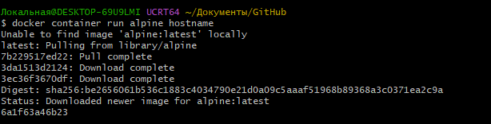
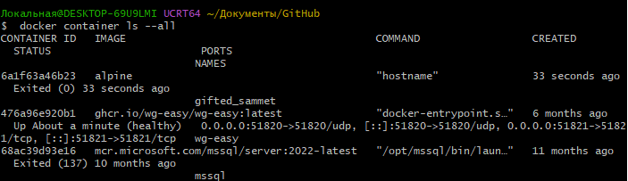

### Интерактивный контейнер (Ubuntu)

```bash
docker container run --interactive --tty --rm ubuntu bash
ls /
ps aux
cat /etc/issue
exit
```
Внутри контейнера `bash` работает как процесс с **PID 1**, а `ps aux` видит только процессы
контейнера. Дистрибутив внутри: **Ubuntu 26.04.1 LTS**. Благодаря `--rm` контейнер удалён после `exit`.

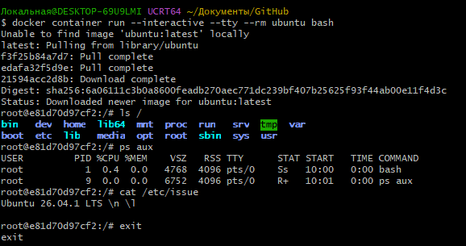

На хосте команда `cat /etc/issue` не работает: хост — Windows, файла `/etc/issue` нет. Это хорошо
показывает, что Linux-контейнер не зависит от ОС, в которой запущен терминал. Docker Desktop
выполняет его в отдельной Linux-VM, потому что Linux-контейнерам нужно ядро Linux.

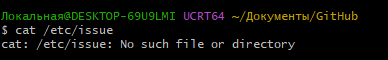

### Фоновый контейнер (MySQL)

```bash
docker container run --detach --name mydb -e MYSQL_ROOT_PASSWORD=my-secret-pw mysql:latest
docker container ls
docker container logs mydb
docker container top mydb
docker exec mydb sh -c 'mysql --user=root --password=$MYSQL_ROOT_PASSWORD --version'
docker exec -it mydb sh
```
- Контейнер `mydb` запущен в фоне (`Up`). Порты `3306/tcp, 33060/tcp` объявлены, но **не опубликованы**
  на хост, поэтому снаружи MySQL недоступен.
- `logs` показывает журнал инициализации сервера, `top` показывает процесс `mysqld` (UID 999).
- Через `docker exec` получена версия: **MySQL 26.10.0** (в инструкции 2019 года была 5.7: `latest`
  со временем указывает на всё новые версии).
- `docker exec -it mydb sh` даёт интерактивную оболочку внутри уже работающего контейнера.

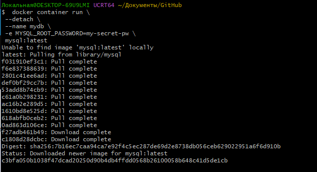
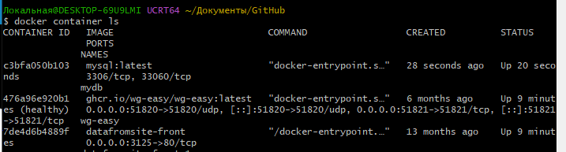
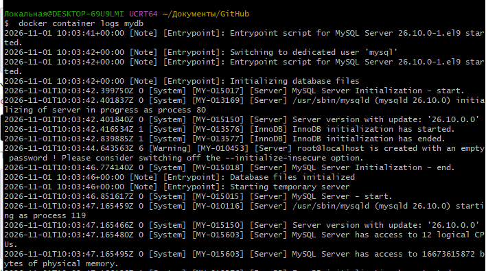
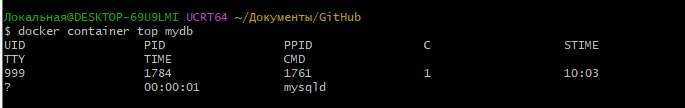
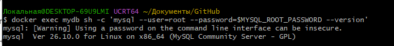
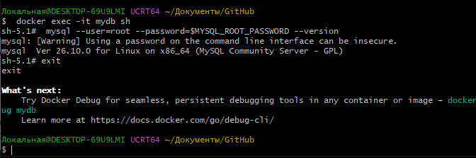

Замечание: в инструкции команда
`docker exec -it mydb mysql --user=root --password=$MYSQL_ROOT_PASSWORD --version` раскрывает
`$MYSQL_ROOT_PASSWORD` в терминале **хоста**, где переменная не задана. Поэтому команда передана
через `sh -c '…'` в одинарных кавычках, и переменная раскрывается внутри контейнера.

---

## Task 2. Собственный образ из Dockerfile

```dockerfile
FROM nginx:latest                          # базовый образ
COPY index.html /usr/share/nginx/html      # файлы сайта копируются в образ
COPY linux.png /usr/share/nginx/html
EXPOSE 80 443                              # документирует используемые порты
CMD ["nginx", "-g", "daemon off;"]         # процесс, запускаемый в контейнере
```

```bash
export DOCKERID=elheid
docker image build --tag $DOCKERID/linux_tweet_app:1.0 .
docker container run --detach --publish 80:80 --name linux_tweet_app $DOCKERID/linux_tweet_app:1.0
docker container rm --force linux_tweet_app
```
Сборка выполнена через BuildKit (`[+] Building 1.3s (8/8) FINISHED`). В выводе видны шаги
`FROM`, `COPY index.html`, `COPY linux.png` и тег `docker.io/elheid/linux_tweet_app:1.0`.
После публикации порта `80:80` сайт открылся на http://localhost.

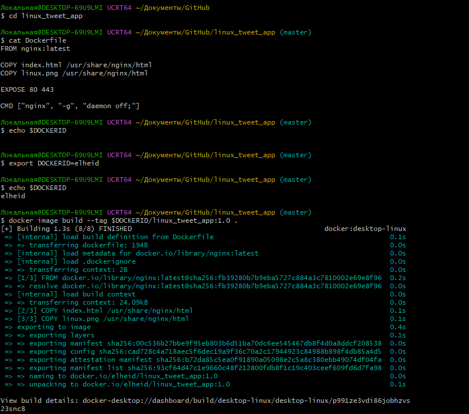
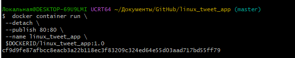
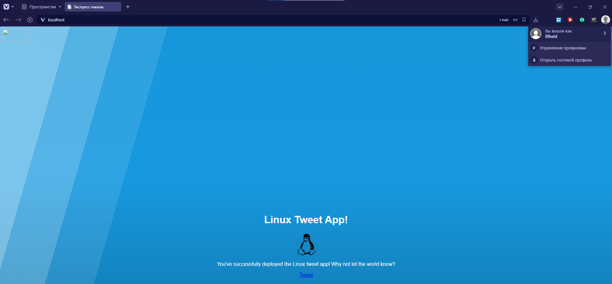
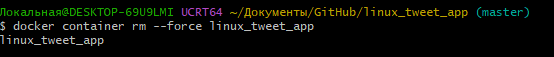

Логотип Docker в левом верхнем углу страницы не загружается: в `index.html` он подключён по
внешней ссылке на docker.com, которая больше не работает. К Docker это отношения не имеет.

---

## Task 3. Изменение работающего сайта

**Bind mount.** Контейнер запущен из каталога с файлами сайта, и этот каталог смонтирован в
`/usr/share/nginx/html`:
```bash
MSYS_NO_PATHCONV=1 docker container run --detach --publish 80:80 --name linux_tweet_app \
  --mount type=bind,source="$(pwd -W)",target=/usr/share/nginx/html \
  $DOCKERID/linux_tweet_app:1.0
cp index-new.html index.html
```
После `cp` и обновления страницы фон стал **оранжевым** без пересборки образа и без перезапуска
контейнера.

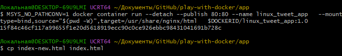
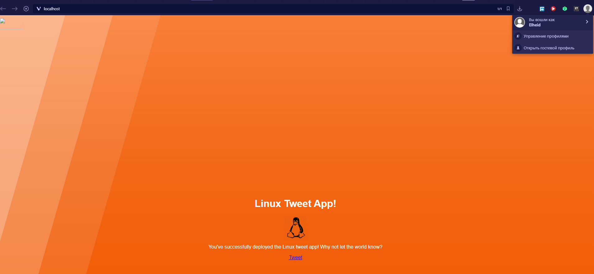

**Образ не изменился.** Контейнер из того же образа `1.0`, но без bind mount, снова показывает
исходную **синюю** страницу: изменились только файлы на хосте.

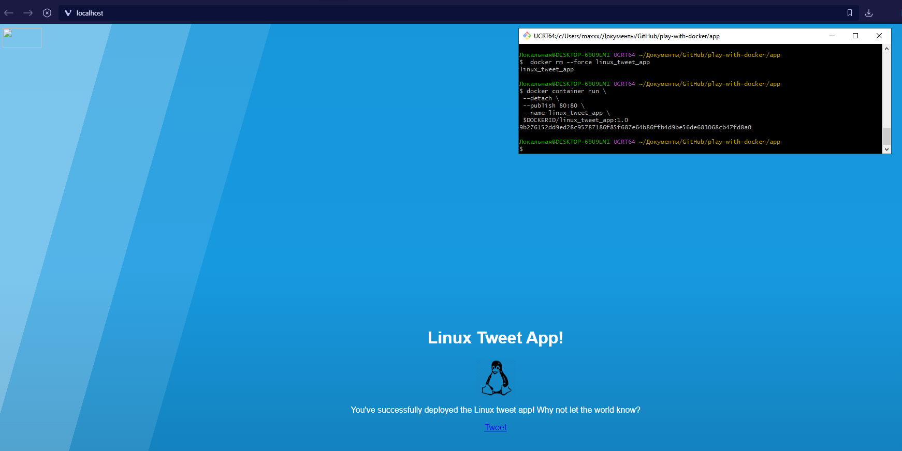

**Версия 2.0 и две версии одновременно.**
```bash
docker image build --tag $DOCKERID/linux_tweet_app:2.0 .
docker image ls
docker container run --detach --publish 80:80   --name linux_tweet_app     $DOCKERID/linux_tweet_app:2.0
docker container run --detach --publish 8080:80 --name old_linux_tweet_app $DOCKERID/linux_tweet_app:1.0
```
На хосте два образа: `elheid/linux_tweet_app:1.0` и `:2.0`. Слева порт 80, версия 2.0 (оранжевая),
справа порт 8080, версия 1.0 (синяя). В Docker Desktop видны оба контейнера с портами `80:80` и
`8080:80`. Два контейнера не могут занять один и тот же порт хоста, поэтому старая версия
опубликована на 8080.

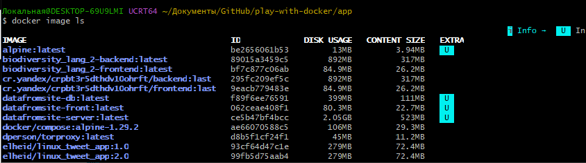
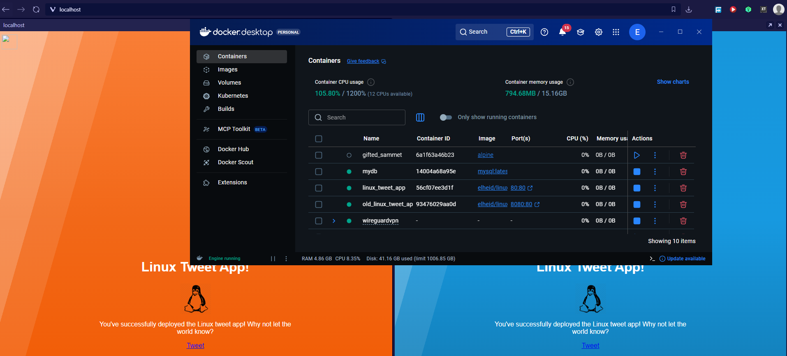

**Публикация на Docker Hub.**
```bash
docker image ls -f reference="$DOCKERID/*"
docker login
docker image push $DOCKERID/linux_tweet_app:1.0
docker image push $DOCKERID/linux_tweet_app:2.0
```
Оба тега, `1.0` и `2.0`, опубликованы в публичном репозитории
[elheid/linux_tweet_app](https://hub.docker.com/r/elheid/linux_tweet_app). Размер образа на Hub
69 MB (в сжатом виде), локально — 279 MB.

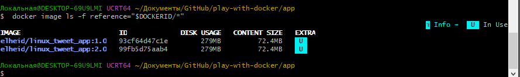
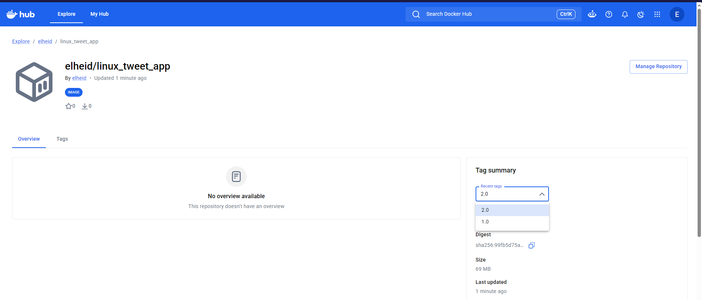

---

## Выводы

1. **Образ и контейнер — разные сущности.** Образ — неизменяемый шаблон из слоёв, контейнер —
   запущенный экземпляр образа. Контейнер работает, пока работает его главный процесс (PID 1):
   `hostname` завершился, и контейнер Alpine сразу перешёл в `Exited`. Без `--rm` остановленные
   контейнеры остаются в системе.
2. **Дистрибутив контейнера не зависит от хоста.** Ubuntu 26.04 и Alpine запускались из Windows.
   При этом Linux-контейнерам нужно ядро Linux, поэтому Docker Desktop держит для них отдельную
   Linux-VM, а на самом хосте даже нет `/etc/issue`.
3. **Контейнеры изолированы.** Процессы контейнера видят только себя (`ps aux`), сеть MySQL
   недоступна с хоста без `--publish`. Внутрь работающего контейнера можно зайти через `docker exec`.
4. **Dockerfile делает сборку воспроизводимой.** Это лучше, чем `docker commit` вручную настроенного
   контейнера. Слои кэшируются, поэтому при сборке версии 2.0 пересобирается только изменившийся слой с `index.html`.
5. **Bind mount удобен при разработке.** Изменения файлов на хосте сразу видны в контейнере, но в
   образ они попадают только после новой сборки.
6. **Теги образов дают версионирование.** Версии 1.0 и 2.0 работают одновременно на разных портах.
7. **Docker Hub — реестр для распространения образов.** После `push` образ можно запустить на любой
   машине с Docker.
8. **Тег `latest` не фиксирует версию.** `mysql:latest` за несколько лет перешёл с 5.7 на 26.10,
   поэтому для воспроизводимости в реальных проектах лучше указывать конкретные теги.

Использованные команды Linux: `ls`, `ps aux`, `cat`, `cd`, `cp`, `pwd`, `echo`, `export`
(переменные окружения), `sh -c`, `exit`.
